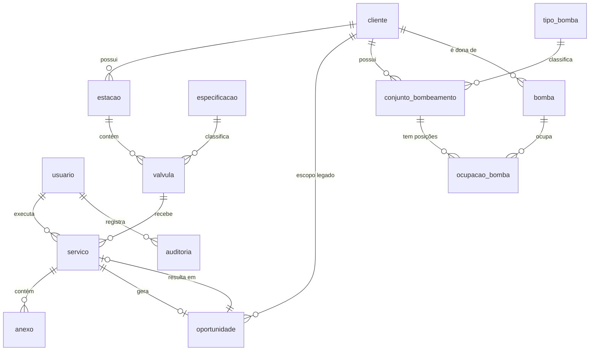

# Modelo de dados — Valtis

Fonte de verdade sobre entidades, campos e relacionamentos. Requisitos em [requirements.md](requirements.md), arquitetura em [architecture.md](architecture.md), justificativas em [decisions.md](decisions.md).

> ⚠️ **Qualquer alteração de schema exige aprovação humana explícita.** Ver AGENTS.md §10. Isso inclui criar, renomear ou remover tabela ou coluna, alterar enum ou constraint, e gerar ou executar migração.

---

## 1. Convenções

| Item | Convenção | Exemplo |
|---|---|---|
| Nome de tabela | Português, **singular**, snake_case | `valvula`, `especificacao`, `oportunidade` |
| Nome de coluna | Português, snake_case | `numero_valvula`, `requer_fechamento_geral` |
| Chave primária | Sempre `id` | `id` |
| Chave estrangeira | `<tabela>_id` | `estacao_id`, `cliente_id` |
| Booleano | Prefixo verbal, sem negação | `ativo`, `requer_fechamento_geral` — **nunca** `nao_ativo` |
| Data/hora | `timestamptz`, armazenada em **UTC** | `criado_em` |
| Data pura | `date` quando não há hora relevante | `data_realizada` |
| Auditoria | `criado_em`, `atualizado_em` em toda tabela de negócio | |
| Exclusão | **Sempre lógica** via `ativo = false` (RN-11) | |

**Por que português nas tabelas:** os termos do domínio não sobrevivem à tradução. `sindico` não é *manager*; `barrilete` e `shaft` não têm equivalente útil. Ver [decisions.md](decisions.md) · D-14.

**Atenção:** o vocabulário é o da planilha, mas os identificadores seguem convenção de banco. A planilha usa `id_equipamento` como chave da aba `equipamentos`; aqui a tabela é `valvula` com PK `id`. O mapeamento está na §6.

## 2. Diagrama



### Hierarquia central

```
cliente (condomínio)
  └── estacao (ponto de instalação: barrilete, shaft…)
        └── valvula (equipamento físico, numerada 01, 02, 03…)
              └── servico (uma intervenção por válvula)
```

> **O serviço pertence à válvula, não à estação** (D-18). Mesmo quando a equipe atende a estação inteira numa única visita, cada válvula gera seu próprio registro — o histórico técnico pertence ao equipamento. A interface pode preencher uma vez e replicar para as demais válvulas da estação, mas isso é conveniência de tela: os registros permanecem independentes.

## 3. Entidades

### usuario
As 3 pessoas com acesso.

| Coluna | Tipo | Notas |
|---|---|---|
| `id` | uuid PK | |
| `nome` | text | |
| `email` | text | único |
| `senha_hash` | text | |
| `perfil` | enum `perfil_usuario` | `tecnico` \| `admin` |
| `ativo` | boolean | padrão `true` |
| `criado_em` | timestamptz | |

### cliente
O condomínio. Uma linha por prédio — **cliente e prédio são a mesma coisa** neste domínio (ver D-17).

| Coluna | Tipo | Notas |
|---|---|---|
| `id` | uuid PK | |
| `codigo_referencia` | text | único. Padrão `COND-001` |
| `nome_condominio` | text | |
| `endereco` | text | |
| `bairro` | text | |
| `cidade` | text | |
| `sindico_responsavel` | text | **dado pessoal — LGPD** (RNF-22) |
| `telefone_contato` | text | **dado pessoal** |
| `email_contato` | text | **dado pessoal** |
| `tipo_atendimento` | enum | `Contrato` \| `Avulso`. Informação comercial; **não** afeta prazo (RN-03) |
| `status_contrato` | enum | `Ativo` \| `Suspenso` \| `Inativo` |
| `ativo` | boolean | |
| `origem` | enum `origem_registro` | `sistema` \| `importacao` |
| `ultima_manutencao_legado` | date, nulo | Só para importados (RF-51) |
| `data_legado_aproximada` | boolean | `true` quando a data veio de metadado de arquivo (RF-58) |
| `cadastro_incompleto` | boolean | `true` para importados sem estação/válvula (RF-53) |
| `criado_em` / `atualizado_em` | timestamptz | |

### especificacao
Catálogo técnico reutilizável. Cadastra-se a combinação uma vez; várias válvulas apontam para ela.

| Coluna | Tipo | Notas |
|---|---|---|
| `id` | uuid PK | |
| `marca` | text | ex.: Bermad, Cla-Val, Dorot |
| `modelo` | text | ex.: 720, 90-01, 300 Series |
| `diametro_polegadas` | text | ex.: `2`, `3`, `1.1/2`. **Texto**, não numérico — polegadas fracionárias |
| `tipo_registro` | enum | `Esfera` \| `Gaveta` |
| `descricao_completa` | text, calculado | `Bermad 720 - 2" Esfera` |
| `ativo` | boolean | |

Único: (`marca`, `modelo`, `diametro_polegadas`, `tipo_registro`).

### estacao
Ponto de instalação que agrupa uma ou mais válvulas. Entidade central do modelo — é o que a empresa fatura (D-07).

| Coluna | Tipo | Notas |
|---|---|---|
| `id` | uuid PK | |
| `cliente_id` | uuid FK → cliente | |
| `localizacao_instalacao` | text | ex.: "Barrilete - Casa de bombas", "Shaft hidráulico - 5º pavimento" |
| `andar_inicial` | integer | **Térreo = 0. Subsolo = negativo** (-1, -2) |
| `andar_final` | integer | |
| `requer_fechamento_geral` | boolean | Se o serviço exige interromper o abastecimento do prédio. Informação operacional crítica — vai no evento do Calendar (RF-29) |
| `ativo` | boolean | |
| `criado_em` / `atualizado_em` | timestamptz | |

> Uma estação comporta **N válvulas** — tipicamente 2, mas pode ter mais (D-19). Nenhuma tela deve assumir limite de duas.
>
> **Pendência P-01 (parcial):** falta definir se a estação contém outros componentes relevantes (filtro Y, manômetros, registros de bloqueio) e se a periodicidade é da válvula ou da estação.

### valvula
O equipamento físico.

| Coluna | Tipo | Notas |
|---|---|---|
| `id` | uuid PK | |
| `estacao_id` | uuid FK → estacao | |
| `especificacao_id` | uuid FK → especificacao | |
| `codigo_referencia` | text | único. `COND-001-VRP-01` (RN-14) |
| `numero_valvula` | text | Sequencial dentro da estação, com zero à esquerda: `01`, `02`, `03`… **Sem limite fixo** (D-19) |
| `numero_serie` | text, nulo | |
| `data_instalacao` | date, nulo | |
| `periodicidade_meses` | integer | **padrão 12**. Editável só em exceções (RN-02) |
| `ativo` | boolean | |
| `criado_em` / `atualizado_em` | timestamptz | |

> **Regra de numeração (`numero_valvula`):**
> **01** = a da **esquerda** quando as válvulas estão em **paralelo** (lado a lado), ou a de **cima** quando estão **uma sobre a outra**.
> As demais seguem na mesma direção de leitura: `02`, `03`, e assim por diante. Válvula única no ponto = **01**.

Único: (`estacao_id`, `numero_valvula`) — base do alerta de duplicidade (RF-13).

### servico
A intervenção realizada. **Uma linha por equipamento atendido** (D-18): válvula **ou** bomba, nunca os dois (RF-80, V6), mesmo quando a visita cobre a estação inteira.

| Coluna | Tipo | Notas |
|---|---|---|
| `id` | uuid PK | |
| `valvula_id` | uuid FK → valvula, nulo | A estação é alcançada por `valvula → estacao`. Nulo no serviço de bomba |
| `bomba_id` | uuid FK → bomba, nulo | RF-80. `ck_servico_equipamento`: exatamente um dos dois |
| `data_realizada` | date | **Informada pelo técnico**, nunca assumida como a data de preenchimento (RF-17). No serviço do Jiraya, a data de execução da OS (P-28) |
| `tipo_manutencao` | enum | `Preventiva` \| `Corretiva` \| `Instalacao` (RN-22) |
| `tecnico_responsavel_id` | uuid FK → usuario, nulo | Nulo no serviço do Jiraya |
| `tecnico_externo` | text, nulo | Técnico vindo do Jiraya, em texto (P-29). `ck_servico_tecnico`: um dos dois preenchido |
| `pecas_substituidas` | text, nulo | |
| `pressao_entrada` | numeric, nulo | **Opcional** (D-10) |
| `pressao_saida` | numeric, nulo | **Opcional** (D-10) |
| `observacoes` | text, nulo | |
| `status` | enum `status_servico` | `rascunho` \| `concluido` |
| `criado_por_id` | uuid FK → usuario, nulo | Pode diferir do técnico responsável. Obrigatório quando `origem = 'manual'` |
| `origem` | `manual` \| `jiraya` | RF-76: o manual aparece como "lançado no Valtis" |
| `jiraya_os_id` | bigint, nulo | OS de origem (RF-74). `ck_servico_os`: preenchido se e só se `origem = 'jiraya'`. Índice único por (OS, válvula) e (OS, bomba): reaplicar a OS não duplica (RN-23) |
| `ativo` | boolean | RN-26. Serviço inativo sai do cálculo do ciclo |
| `motivo_inativacao`, `inativado_por_id`, `inativado_em` | | Obrigatórios ao inativar (`ck_servico_inativacao`) |
| `criado_em` / `atualizado_em` | timestamptz | `criado_em` ≠ `data_realizada` — ver D-02 |

**Nunca sobrescrever** um serviço anterior. Toda intervenção é uma linha nova (RF-18). A única mudança é a inativação, com motivo (RN-26).

> **Sobre atendimentos simultâneos:** quando três válvulas da mesma estação são atendidas na mesma visita, o resultado são **três linhas** de `servico` com a mesma `data_realizada` e o mesmo técnico. Isso é intencional — o histórico técnico pertence ao equipamento, e válvulas do mesmo barrilete podem ter idades, marcas e desgastes diferentes. Não introduza uma entidade "visita" para agrupá-las sem aprovação (AGENTS.md §10).

### anexo
Fotos do atendimento.

| Coluna | Tipo | Notas |
|---|---|---|
| `id` | uuid PK | |
| `servico_id` | uuid FK → servico | |
| `valvula_id` | uuid FK → valvula, nulo | Quando a foto é de uma válvula específica |
| `caminho_arquivo` | text | Referência no object storage, não o binário |
| `tipo_mime` | text | |
| `tamanho_bytes` | bigint | |
| `legenda` | text, nulo | |
| `criado_em` | timestamptz | |

### oportunidade
O retorno previsto e seu desfecho comercial. É a entidade que transforma "dinheiro na mesa" em número mensurável.

| Coluna | Tipo | Notas |
|---|---|---|
| `id` | uuid PK | |
| `escopo` | enum `escopo_oportunidade` | `valvula` \| `cliente` — ver nota abaixo |
| `cliente_id` | uuid FK → cliente | sempre preenchido |
| `valvula_id` | uuid FK → valvula, nulo | **nulo quando `escopo = cliente`** |
| `servico_origem_id` | uuid FK → servico, nulo | nulo quando importada |
| `data_prevista` | date | `data_realizada + periodicidade_meses` (RN-01). As datas dos alertas (RN-06) são **derivadas** dela, não gravadas (D-21) |
| `status` | enum `status_oportunidade` | `agendado` \| `contatado` \| `aceito` \| `recusado` \| `executado` \| `perdido` \| `cancelado` (V7). Os três primeiros são **abertos**. `cancelado` só vem da inativação do serviço de origem sem outra data-base (RN-26, P-32) e não conta como receita perdida |
| `responsavel_id` | uuid FK → usuario, nulo | **nulo até alguém assumir** (RN-07, D-04) |
| `assumida_em` | timestamptz, nulo | |
| `motivo_recusa` | text, nulo | RF-45 |
| `origem` | enum `origem_registro` | `sistema` \| `importacao` |
| `notas` | text, nulo | |
| `servico_resultante_id` | uuid FK → servico, nulo | fecha o ciclo (RN-10) |
| `oportunidade_anterior_id` | uuid FK → oportunidade, nulo | a recusada que originou esta, quando o cliente pediu para ser lembrado (RN-09) |
| `encerrada_em` | timestamptz, nulo | quando saiu dos estados abertos |
| `criado_em` / `atualizado_em` | timestamptz | |

Restrições: escopo `valvula` exige `valvula_id`, escopo `cliente` proíbe (`ck_oportunidade_escopo`). **No máximo um ciclo aberto por válvula** (índice único parcial `ux_oportunidade_aberta_por_valvula`).

> **Regras implementadas no lançamento:** um serviço novo fecha como `executado` as oportunidades abertas da válvula e as de escopo cliente do mesmo cliente (RN-10, RF-59), e abre a próxima (RN-07). Um serviço **mais antigo** que o último já lançado entra no histórico, mas não mexe no ciclo.

### evento_agenda
A fila de saída para o Google Calendar (Outbox, D-13 e D-21). Uma linha por alerta.

| Coluna | Tipo | Notas |
|---|---|---|
| `id` | uuid PK | também origina o id do evento no Google (idempotência) |
| `oportunidade_id` | uuid FK → oportunidade | |
| `tipo` | enum `tipo_evento` | `alerta_comercial` \| `lembrete_final` |
| `data_evento` | date | `data_prevista − 30` ou `− 7` dias, conforme configuração |
| `status` | enum `status_evento` | `pendente` \| `criado` \| `falhou` \| `descartado` |
| `google_event_id` | text, nulo | preenchido pelo worker |
| `tentativas` | integer | padrão 0 |
| `proxima_tentativa_em` | timestamptz | espera crescente entre falhas |
| `ultimo_erro` | text, nulo | mensagem técnica, sem dado pessoal (RF-33) |
| `sincronizado_em` | timestamptz, nulo | |
| `criado_em` / `atualizado_em` | timestamptz | |

Único: (`oportunidade_id`, `tipo`). Alerta com data já passada não é enfileirado (RN-13).

> **O campo `escopo` é o que viabiliza a importação (D-09).** A base real não tem informação de qual válvula foi atendida — só cliente e data. Esses 296 clientes geram oportunidades de **escopo cliente**, sem válvula vinculada. Quando o técnico visitar e cadastrar as válvulas, os ciclos seguintes passam a ser de escopo válvula.

### auditoria

| Coluna | Tipo |
|---|---|
| `id` | uuid PK |
| `usuario_id` | uuid FK → usuario |
| `entidade` | text |
| `entidade_id` | uuid |
| `acao` | enum: `criou` \| `alterou` \| `inativou` |
| `dados_antes` | jsonb, nulo |
| `dados_depois` | jsonb, nulo |
| `criado_em` | timestamptz |

## 4. Enums {#enums}

Valores fixos vindos da planilha da Manutec. **A interface usa lista suspensa; nunca texto livre** (RNF-06).

| Enum | Valores |
|---|---|
| `perfil_usuario` | `tecnico` · `admin` |
| `tipo_atendimento` | `Contrato` · `Avulso` |
| `status_contrato` | `Ativo` · `Suspenso` · `Inativo` |
| `tipo_registro` | `Esfera` · `Gaveta` |
| `tipo_manutencao` | `Preventiva` · `Corretiva` · `Instalacao` (V6) |
| `origem_servico` | `manual` · `jiraya` (V6) |
| `status_servico` | `rascunho` · `concluido` |
| `status_oportunidade` | `agendado` · `contatado` · `aceito` · `recusado` · `executado` · `perdido` · `cancelado` (V7) |
| `escopo_oportunidade` | `valvula` · `bomba` (V6) · `cliente` |
| `origem_registro` | `sistema` · `importacao` · `integracao` (V6, só em `cliente`) |
| `estado_evento_recebido` | `pendente` · `aplicado` · `pendencia` · `falhou` · `descartado` · `superado` (§8a) |
| `tipo_evento` | `alerta_comercial` · `lembrete_final` |
| `status_evento` | `pendente` · `criado` · `falhou` · `descartado` |
| `natureza_ocupacao` | `instalacao` · `emprestimo` (§8) |
| `motivo_encerramento` | `retirada` · `devolucao` (§8) |
| `status_painel` | **calculado, não persistido** — ver §5 |

## 5. Status do painel — calculado, nunca armazenado

`status_painel` e `dias_restantes` **não são colunas**. São derivados na consulta (D-15), porque mudam sozinhos com a passagem do tempo — armazená-los criaria painel desatualizado.

| Status | Condição |
|---|---|
| `SEM REGISTRO` | Válvula sem nenhum serviço lançado. **Não gera oportunidade** (RN-05) |
| `VENCIDO` | `dias_restantes < 0` |
| `PRÓXIMO DO VENCIMENTO` | `0 ≤ dias_restantes ≤ 30` |
| `EM DIA` | `dias_restantes > 30` |

Onde `dias_restantes = data_proxima_manutencao − hoje`, e `data_proxima_manutencao = último data_realizada + periodicidade_meses`.

## 6. Importação da base legada {#importação-da-base-legada}

Origem: `RELATORIO NF MANUTENCAO VALVULAS - CONSOLIDADO.xlsx`, abas `Alertas` e `Matriz Cliente x Ano`. Escopo definido em D-09.

### O que entra

| Campo de destino | Origem | Observação |
|---|---|---|
| `cliente.nome_condominio` | `Cliente / Edifício` | Requer limpeza — ver riscos |
| `cliente.ultima_manutencao_legado` | `Última manutenção` | **Data aproximada** |
| `cliente.data_legado_aproximada` | — | Sempre `true` |
| `cliente.origem` | — | Sempre `importacao` |
| `cliente.cadastro_incompleto` | — | Sempre `true` |
| `oportunidade` | derivada | `escopo = cliente`, sem válvula |

### O que **não** entra

- As 595 intervenções individuais (RF-52). Só o cliente e a data do último atendimento.
- Estações e válvulas — a base real não tem essa informação. Serão cadastradas na próxima visita, com o técnico na frente do equipamento.
- **Eventos retroativos no Calendar** (RN-13). Criar 205 eventos no passado inutilizaria a agenda. Esses clientes aparecem no painel como lista de ação imediata.

### Riscos conhecidos da base legada

**As datas são aproximadas.** A planilha avisa: *"Data = data de modificação do arquivo; pode diferir da data de emissão impressa na NF."* Para os 153 clientes com 24+ meses sem manutenção isso é irrelevante — a ação é a mesma. Importa para quem está perto da janela. Daí o `data_legado_aproximada`.

**Nomes inconsistentes.** Amostras reais: `02 OPERA CLASSIC`, `02 TSAR`, `1976ED CAIS DA AURORA`. Prefixos numéricos são resíduo de nome de pasta. O mesmo condomínio provavelmente aparece com grafias diferentes entre as bases `RECIBOS` (409 NFs) e `MANUTEC VRP` (186 NFs).

**A deduplicação é assistida, nunca automática** (RF-57). O sistema agrupa candidatos por similaridade e **o humano decide** o que é o mesmo cliente. Deduplicar sozinho pode fundir dois condomínios distintos — erro silencioso e difícil de desfazer.

### Mapeamento planilha de controle → banco

Referência de vocabulário: `Controle_Manutencao_VRP_Final.xlsx`.

| Aba / coluna da planilha | Tabela / coluna |
|---|---|
| `clientes.id_cliente` | `cliente.id` |
| `clientes.*` | `cliente.*` (mesmos nomes) |
| `catalogo_especificacoes.id_especificacao` | `especificacao.id` |
| `equipamentos.id_equipamento` | `valvula.id` |
| `equipamentos.codigo_referencia_equipamento` | `valvula.codigo_referencia` |
| `equipamentos.localizacao_instalacao` | `estacao.localizacao_instalacao` |
| `equipamentos.andar_inicial` / `andar_final` | `estacao.andar_inicial` / `andar_final` |
| `equipamentos.requer_fechamento_geral` | `estacao.requer_fechamento_geral` |
| `historico_manutencoes.id_manutencao` | `servico.id` |
| `historico_manutencoes.data_realizada` | `servico.data_realizada` |
| `historico_manutencoes.id_equipamento` | `servico.valvula_id` |
| `historico_manutencoes.pecas_substituidas` | `servico.pecas_substituidas` |
| `painel_status.*` | **não persistido** — calculado (§5) |
| `legenda_regras` (dias de alerta) | configuração da aplicação |

> As colunas `localizacao_instalacao`, `andar_inicial`, `andar_final` e `requer_fechamento_geral` são repetidas por válvula na planilha. Ao migrar, elas **sobem** para `estacao` — foi essa repetição que revelou a existência da estação como entidade (D-17).

## 7. Índices sugeridos

Poucos, e só onde há consulta real. O volume não justifica mais (RNF-12).

- `valvula (estacao_id)`
- `estacao (cliente_id)`
- `servico (valvula_id, data_realizada DESC)` — histórico e cálculo do último serviço de cada válvula
- `oportunidade (status, data_prevista)` — consulta principal da fila
- `oportunidade (valvula_id) WHERE status IN (abertos)`, **único** — um ciclo aberto por válvula
- `evento_agenda (proxima_tentativa_em) WHERE status = 'pendente'` — varredura do worker do Outbox
- `cliente (nome_condominio)` — busca

Implementados em `V2__schema_inicial.sql`, `V4__oportunidade_e_agenda.sql` e `V5__modulo_bombas.sql` (§8). A V4 também remove a tabela `teste_conexao` da Fase 0. A `V7__oportunidade_cancelada.sql` (01/11/2026) só alarga o CHECK de `oportunidade.status` com `cancelado` (agora `ck_oportunidade_status`).

## 8. Módulo de bombas {#módulo-de-bombas}

> Modelo do MVP 1 de bombas (RF-60 a RF-68, D-26, D-27). **Aprovado pelo Daniel em 20/10/2026** e criado pela migração `V5__modulo_bombas.sql`. O módulo de válvulas (§3) não foi alterado.

### Hierarquia

```
cliente (condomínio)
  └── conjunto_bombeamento (recalque, incêndio, drenagem…)
        └── posição 01, 02, …  ──ocupada por──►  bomba (equipamento físico)

bomba patrimonial da Manutec: sem cliente; ocupa posições por empréstimo
```

A bomba **não** aponta para o conjunto. Quem liga bomba a posição é `ocupacao_bomba`, com período (D-27). A tabela `bomba` guarda a identidade e os dados técnicos; a tabela `ocupacao_bomba` guarda onde ela esteve e está.

### tipo_bomba
Catálogo configurável (RF-60). A migração insere os oito tipos iniciais.

| Coluna | Tipo | Notas |
|---|---|---|
| `id` | uuid PK | |
| `nome` | text | único, sem diferença de maiúsculas (índice em `lower(nome)`) |
| `ativo` | boolean | inativar tira da lista suspensa; conjuntos existentes mantêm o tipo |
| `criado_em` | timestamptz | |

Iniciais: `Recalque` · `Incêndio` · `Drenagem` · `Pressurização` · `Pluvial` · `Piscina` · `Jacuzzi` · `Esgoto`.

### conjunto_bombeamento
O agrupamento de bombas de uma função no prédio. Equivale à `estacao` das válvulas.

| Coluna | Tipo | Notas |
|---|---|---|
| `id` | uuid PK | |
| `cliente_id` | uuid FK → cliente | |
| `tipo_bomba_id` | uuid FK → tipo_bomba | tipo é do conjunto (P-15) |
| `localizacao` | text | ex.: "Casa de bombas - subsolo 2" |
| `observacoes` | text, nulo | |
| `ativo` | boolean | |
| `criado_em` / `atualizado_em` | timestamptz | |

### bomba
O equipamento físico, com identidade permanente.

| Coluna | Tipo | Notas |
|---|---|---|
| `id` | uuid PK | |
| `codigo_referencia` | text | único. `COND-001-BMB-01` ou `MAN-BMB-001` (RN-15) |
| `patrimonio_manutec` | boolean | `true` = bomba própria da Manutec (RF-65) |
| `cliente_id` | uuid FK → cliente, nulo | dono, quando é do condomínio. **Nulo se e só se `patrimonio_manutec`** (`ck_bomba_dono`) |
| `fabricante` | text, nulo | RF-63: pode ficar em branco |
| `modelo` | text, nulo | idem |
| `potencia_cv` | numeric(6,2), nulo | idem |
| `tensao_volts` | integer, nulo | idem |
| `corrente_amperes` | numeric(6,2), nulo | idem |
| `funcao` | text, nulo | ex.: "principal", "reserva" (P-15) |
| `data_instalacao` | date, nulo | |
| `periodicidade_meses` | integer | obrigatória, sem padrão até P-13. `> 0` |
| `ultima_manutencao` | date, nulo | informada no cadastro (P-16). Próxima = calculada (RN-16) |
| `ativo` | boolean | |
| `criado_em` / `atualizado_em` | timestamptz | |

**Calculados, não gravados** (D-15, D-27): `proxima_manutencao`, `status_painel`, `dados_tecnicos_incompletos` (algum dos cinco campos técnicos nulo), `posicao_atual` e `disponivel` (a partir das ocupações abertas).

### ocupacao_bomba
Um período em que uma bomba ocupou uma posição de um conjunto. Histórico puro: nunca se apaga nem se reescreve (RN-20).

| Coluna | Tipo | Notas |
|---|---|---|
| `id` | uuid PK | |
| `bomba_id` | uuid FK → bomba | |
| `conjunto_id` | uuid FK → conjunto_bombeamento | |
| `numero_posicao` | text | `01`, `02`… sequencial no conjunto, mesma convenção de `numero_valvula` |
| `natureza` | enum `natureza_ocupacao` | `instalacao` (bomba do próprio condomínio) \| `emprestimo` (bomba patrimonial da Manutec) |
| `bomba_substituida_id` | uuid FK → bomba, nulo | a que saiu para esta entrar (RF-66) |
| `inicio` | date | |
| `fim` | date, nulo | **nulo = ocupação aberta.** Preenchido na retirada ou devolução (RN-18) |
| `motivo_encerramento` | enum `motivo_encerramento`, nulo | `retirada` \| `devolucao`. Obrigatório quando `fim` preenchido (`ck_ocupacao_encerramento`) |
| `observacoes` | text, nulo | |
| `registrado_por_id` | uuid FK → usuario | |
| `criado_em` | timestamptz | |

Restrições: `fim >= inicio`; `natureza = emprestimo` só para bomba com `patrimonio_manutec` (regra de serviço, não cabe em CHECK entre tabelas). **Sem** unicidade de ocupação aberta por posição — RN-19 exige permitir duas (a original reinstalada e a emprestada ainda lá).

### Enums novos

| Enum | Valores |
|---|---|
| `natureza_ocupacao` | `instalacao` · `emprestimo` |
| `motivo_encerramento` | `retirada` · `devolucao` |

Como as demais: `VARCHAR` + `CHECK`, não enum nativo (ver `V2`).

### Índices

- `conjunto_bombeamento (cliente_id)`
- `bomba (cliente_id)`
- `ocupacao_bomba (bomba_id) WHERE fim IS NULL` — "onde está" e disponibilidade (RN-17)
- `ocupacao_bomba (conjunto_id, numero_posicao) WHERE fim IS NULL` — quem ocupa cada posição
- `tipo_bomba (lower(nome))`, único

### Migração `V5__modulo_bombas.sql`

```sql
CREATE TABLE tipo_bomba (
    id        UUID PRIMARY KEY DEFAULT gen_random_uuid(),
    nome      TEXT        NOT NULL,
    ativo     BOOLEAN     NOT NULL DEFAULT TRUE,
    criado_em TIMESTAMPTZ NOT NULL DEFAULT NOW()
);
CREATE UNIQUE INDEX ux_tipo_bomba_nome ON tipo_bomba (lower(nome));
INSERT INTO tipo_bomba (nome) VALUES
    ('Recalque'), ('Incêndio'), ('Drenagem'), ('Pressurização'),
    ('Pluvial'), ('Piscina'), ('Jacuzzi'), ('Esgoto');

CREATE TABLE conjunto_bombeamento (
    id            UUID PRIMARY KEY DEFAULT gen_random_uuid(),
    cliente_id    UUID        NOT NULL REFERENCES cliente (id),
    tipo_bomba_id UUID        NOT NULL REFERENCES tipo_bomba (id),
    localizacao   TEXT        NOT NULL,
    observacoes   TEXT,
    ativo         BOOLEAN     NOT NULL DEFAULT TRUE,
    criado_em     TIMESTAMPTZ NOT NULL DEFAULT NOW(),
    atualizado_em TIMESTAMPTZ NOT NULL DEFAULT NOW()
);
CREATE INDEX idx_conjunto_cliente ON conjunto_bombeamento (cliente_id);

CREATE TABLE bomba (
    id                  UUID PRIMARY KEY DEFAULT gen_random_uuid(),
    codigo_referencia   TEXT        NOT NULL UNIQUE,
    patrimonio_manutec  BOOLEAN     NOT NULL DEFAULT FALSE,
    cliente_id          UUID        REFERENCES cliente (id),
    fabricante          TEXT,
    modelo              TEXT,
    potencia_cv         NUMERIC(6, 2),
    tensao_volts        INTEGER,
    corrente_amperes    NUMERIC(6, 2),
    funcao              TEXT,
    data_instalacao     DATE,
    periodicidade_meses INTEGER     NOT NULL,
    ultima_manutencao   DATE,
    ativo               BOOLEAN     NOT NULL DEFAULT TRUE,
    criado_em           TIMESTAMPTZ NOT NULL DEFAULT NOW(),
    atualizado_em       TIMESTAMPTZ NOT NULL DEFAULT NOW(),
    CONSTRAINT ck_bomba_periodicidade CHECK (periodicidade_meses > 0),
    CONSTRAINT ck_bomba_dono CHECK (patrimonio_manutec = (cliente_id IS NULL))
);
CREATE INDEX idx_bomba_cliente ON bomba (cliente_id);

CREATE TABLE ocupacao_bomba (
    id                   UUID PRIMARY KEY DEFAULT gen_random_uuid(),
    bomba_id             UUID        NOT NULL REFERENCES bomba (id),
    conjunto_id          UUID        NOT NULL REFERENCES conjunto_bombeamento (id),
    numero_posicao       TEXT        NOT NULL,
    natureza             VARCHAR(20) NOT NULL CHECK (natureza IN ('instalacao', 'emprestimo')),
    bomba_substituida_id UUID        REFERENCES bomba (id),
    inicio               DATE        NOT NULL,
    fim                  DATE,
    motivo_encerramento  VARCHAR(20) CHECK (motivo_encerramento IN ('retirada', 'devolucao')),
    observacoes          TEXT,
    registrado_por_id    UUID        NOT NULL REFERENCES usuario (id),
    criado_em            TIMESTAMPTZ NOT NULL DEFAULT NOW(),
    CONSTRAINT ck_ocupacao_periodo      CHECK (fim IS NULL OR fim >= inicio),
    CONSTRAINT ck_ocupacao_encerramento CHECK ((fim IS NULL) = (motivo_encerramento IS NULL))
);
CREATE INDEX idx_ocupacao_bomba_aberta    ON ocupacao_bomba (bomba_id) WHERE fim IS NULL;
CREATE INDEX idx_ocupacao_posicao_aberta  ON ocupacao_bomba (conjunto_id, numero_posicao) WHERE fim IS NULL;
```

## 8a. Modo integrado: migração `V6__modo_integrado.sql` {#modo-integrado}

Aprovada pelo Daniel em 01/11/2026. A proposta com o porquê de cada coluna e as decisões Q-1 a Q-4 está em [`docs/integracao/schema-v6.md`](integracao/schema-v6.md); o SQL vigente é o da migração. Aditiva e não destrutiva.

**As tabelas são as mesmas nos dois modos; só muda quem escreve nelas (D-29).** Resumo:

| Tabela | O que o V6 acrescenta |
|---|---|
| `cliente` | `manutec_id` (único), `fonte_atualizado_em` (texto exato da fonte), `sincronizado_em`; `origem` aceita `integracao` |
| `estacao` | Andares opcionais, os dois juntos (`ck_estacao_andares_juntos`): a estação derivada fica "a completar" (Q-2). `chave_integracao`, única por cliente: a localização interna normalizada (RF-73) |
| `valvula` | `jiraya_equipamento_id` (único), `fonte_atualizado_em`, `sincronizado_em`, `fabricante`, `modelo`, `identificacao_externa`. Especificação opcional só na espelhada (`ck_valvula_especificacao`, Q-1) |
| `bomba` | `jiraya_equipamento_id` (único), `fonte_atualizado_em`, `sincronizado_em`, `identificacao_externa`; periodicidade com padrão 12 (P-22) |
| `conjunto_bombeamento` | `chave_integracao`, única por (cliente, tipo, chave) (Q-4) |
| `ocupacao_bomba` | `origem` (`manual` \| `integracao`); `registrado_por_id` obrigatório só na manual |
| `servico` | Ver §3: válvula ou bomba, origem, OS, técnico externo, inativação |
| `oportunidade` | `bomba_id` e escopo `bomba`; índice "um ciclo aberto por bomba" |
| `evento_recebido` | **Nova.** Fila de entrada, o Outbox invertido (D-30): origem, tipo, id externo, versão, corpo (jsonb), estado, motivo, retentativa, resolução. Único em (origem, tipo, id externo, versão) (RN-23); descartar exige justificativa |
| `cursor_integracao` | **Nova.** Uma linha por (origem, recurso): `desde` (texto exato), `apos_id`, última leitura, última leitura bem-sucedida, último erro (RF-78) |

**RN-24 por campo** (Q-2): na entidade espelhada, o campo que vem da fonte é só leitura e é sobrescrito a cada sincronização; o campo que a fonte não tem (andares, fechamento geral, especificação, periodicidade, data de instalação, tipo de atendimento) é do Valtis e nunca é sobrescrito.

**Última manutenção da bomba:** a data-base do ciclo é a mais recente entre `bomba.ultima_manutencao` (informada no cadastro, P-16) e o último serviço ativo da bomba. É calculada, nunca gravada (D-15).

## 9. Glossário do domínio {#glossário-do-domínio}

| Termo | Significado |
|---|---|
| **VRP** | Válvula Redutora de Pressão. Reduz a pressão da rede para faixas seguras de uso predial |
| **Estação redutora** | Conjunto que contém várias VRPs, geralmente em paralelo, atendendo uma faixa de andares. É a unidade faturada |
| **Barrilete** | Tubulação de distribuição, normalmente na casa de bombas |
| **Shaft** | Prumada vertical de tubulação, por onde passam as instalações entre pavimentos |
| **Fechamento geral** | Necessidade de interromper o abastecimento do prédio inteiro para executar o serviço |
| **Filtro Y** | Filtro instalado a montante da válvula para reter sujeira |
| **Piloto** | Componente que comanda a regulagem da VRP |
| **Síndico** | Representante legal do condomínio. Papel jurídico brasileiro, sem equivalente direto em inglês |
| **Administradora** | Empresa que gere o condomínio; muitas vezes é quem aprova o serviço |
| **Avulso × Contrato** | Modalidade comercial do atendimento. Não altera a periodicidade técnica (RN-03) |
| **Soft delete** | Inativação lógica; o registro permanece no banco (RN-11) |
| **Outbox** | Padrão em que a integração externa é gravada no banco e executada depois, em segundo plano |
| **Conjunto de bombeamento** | Grupo de bombas de uma mesma função no prédio (recalque, incêndio…). Equivale à estação, para bombas |
| **Bomba patrimonial** | Bomba própria da Manutec, emprestada a condomínios enquanto a deles está em conserto |
| **Ocupação** | Período em que uma bomba esteve numa posição de um conjunto. É o que diz onde a bomba está (D-27) |
| **Recalque** | Bombeamento da cisterna para a caixa d'água superior. O tipo mais comum em prédio |
